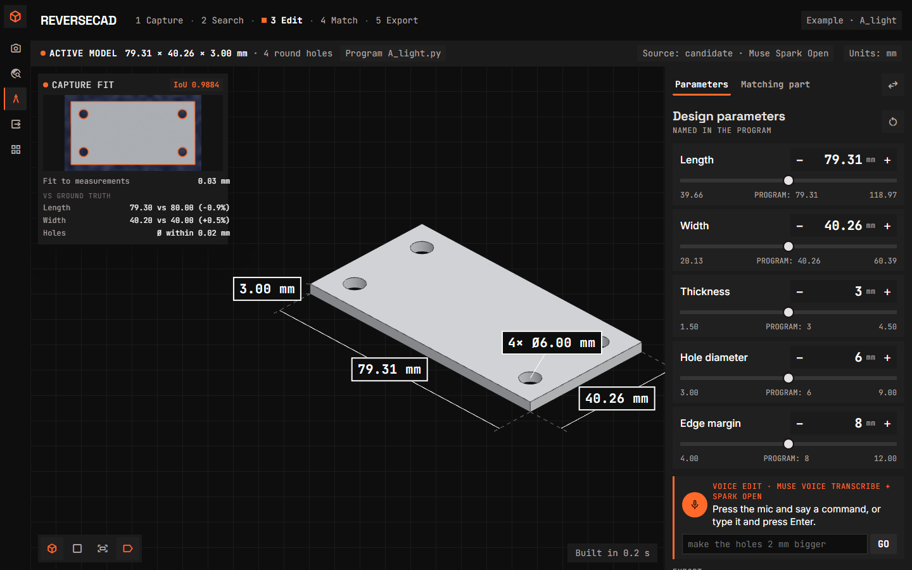
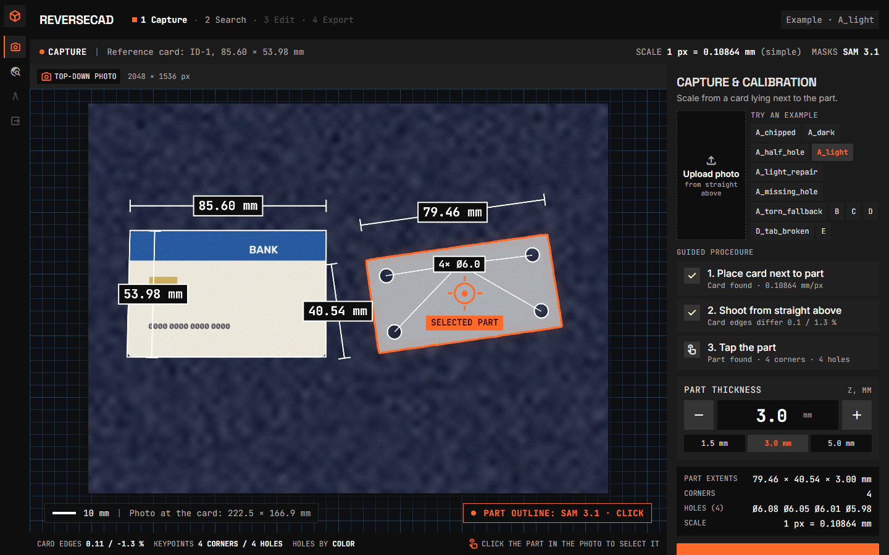
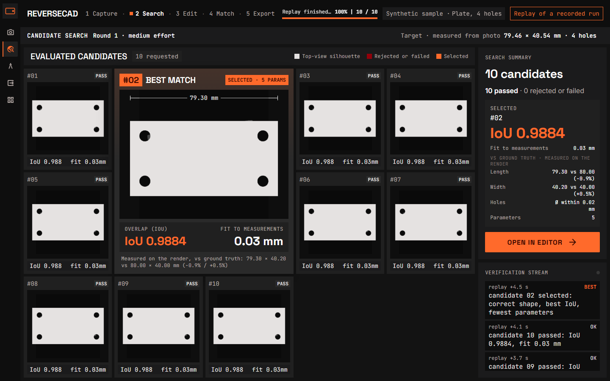
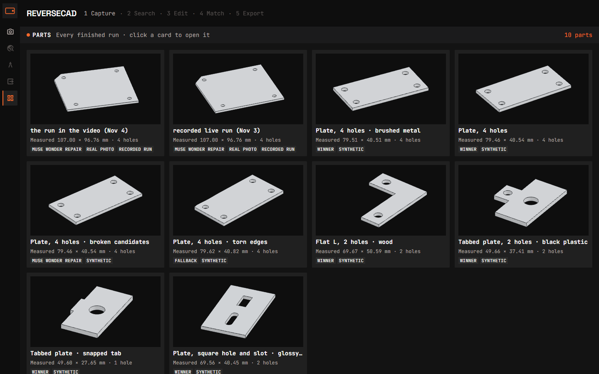
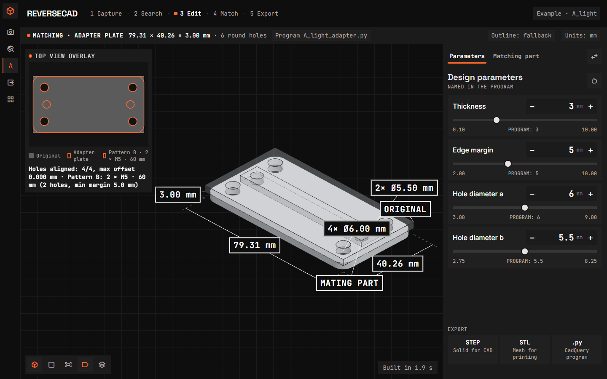
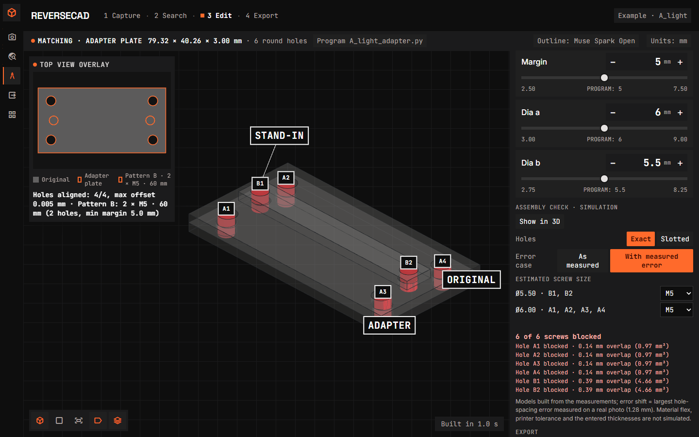

# ReverseCAD

One photo of a flat part → an editable CAD program with real millimeter dimensions.

The core of ReverseCAD — writing every candidate CAD program — runs on Muse Spark Open, Meta's open-weight model, served through Baseten.



Demo video: <!-- TODO: video link, Nov 3 -->

Built during the Meta Global AI Developer Hackathon (Oct 26 – Nov 4); the repo history starts Oct 27. Everything below was written during the hackathon.

**Live demo (no install, saved samples):** https://zeynepsdklc--reversecad-demo-web.us-east.modal.run

## The problem

A flat bracket, cover, or gasket breaks or is discontinued, and the device it belongs to cannot be repaired without a replacement. Cutting a new one needs a CAD model, and today people measure the old part with calipers or trace a photo with a ruler by hand. Phone 3D-scanning apps give a mesh, with no named dimensions to edit, and its scale has to be set by hand. ReverseCAD turns that manual step into one photo: the part next to a bank card becomes an editable CAD program with real millimeter dimensions — not a dead mesh.

### Why this matters

- ["what im not sure about is the scaling."](https://forum.prusaprinters.org/forum/original-prusa-i3-mk3s-mk3-how-do-i-print-this-printing-help/designing-from-a-photo/)
- ["This seems the perfect answer to a discontinued part."](https://hubs.com/talk/t/in-baltimore-area-need-item-scanned-then-printed/6079)
- ["How do I accurately measure the distance between these two holes?"](https://www.reddit.com/r/3Dprinting/comments/1vwv5zy/how_do_i_accurately_measure_the_distance_between/)

## Scope

Flat parts with holes, by choice: brackets, mounting plates, gaskets, covers, adapter plates — the parts laser cutters, CNC mills, and 3D printers make. One top-down photo with an ID-1 card (85.60 × 53.98 mm) next to the part sets the scale; thickness is entered by hand, since a top view cannot show it. Output is an editable CadQuery program plus STL, STEP, DXF, and a 1:1 print template.

## How it works

Code measures, the model decides the structure, every program is checked against the photo.

1. **Photo**: the part lies next to an ID-1 card (bank or transit card), shot from above.
2. **Masks (SAM 3.1)**: the card is found by name, the part by the user's click (a SAM point prompt).
3. **Measurements (deterministic code, no language model)**: the card gives the pixel-to-millimeter scale (simple mean scale, or a homography when the card's opposite edges differ by more than 2%); the code measures the outline, its corners and arcs, and every hole (circle, rectangle, slot, ellipse, or polygon) in millimeters.
4. **Candidates (Muse Spark Open)**: the model gets the measurement table and the part's black-and-white silhouette and writes several CadQuery programs, asked in turn with three approaches (fewest parameters, feature based, symmetry first). It decides the structure and the parameter names; every number comes from the table. The live search stops once three passing candidates build the same shape.
5. **Checks**: each program is screened (only `cadquery`, `math`, and the helper library `partkit` may be imported), built in a separate process, rendered from above and compared with the photo's mask (IoU), and checked against the measurements (holes within 0.5 mm, outline within max(1 mm, 2%)).
6. **Repair (Muse Wonder)**: if no program passes every check, Wonder sees the failed programs with their difference images and rejection reasons, explains what is wrong, and writes a corrected program, which goes through the same checks (at most 2 rounds).
7. **Result**: the best program wins. If none passes, a baseline built straight from the measurements is returned, clearly marked as `fallback: measured shape, no design intent`, and the app says why (for example "The edges are irregular; the measured shape is shown.").
8. **Completion (Muse Wonder)**: if the code finds signs that the part itself is broken (a zigzag edge, material missing against its mirror image, a gap or a half hole in a hole pattern), Wonder suggests how the intact part was designed. The suggestion is a separate, checked program. The card says which added numbers are measured and which are estimated, asks for the estimated ones (with a suggested value), and asks whether to add features the photo cannot show; the user applies or ignores it.


*Card, outline, and holes drawn over the photo with their sizes.*


*Programs arrive one by one with their silhouette, IoU, and rejection reasons.*


*The result with one slider per named parameter.*

## The agent loop

In one run the system decides on its own: it writes candidates in three approaches (fewest parameters, feature based, symmetry first), builds each program and checks it against the photo, rejects failures with a stated reason, and stops the search once 3 passing candidates build the same shape (early stop on 258 of 300 random parts, 3.42 of 5 requests on average). When no candidate passes, it calls Muse Wonder to diagnose and repair (at most 2 rounds): 6/6 synthetic cases repaired in round 1, and on the real cardboard both photos had all 5 candidates rejected with the repair passing in round 1. It then looks for break cues and asks Wonder for a completion, or falls back to the measured shape and says why. The user keeps the final say on anything the photo cannot show: estimated values in a completion come with a suggested value, and the suggestion waits for Apply / Ignore.

## Where Meta models are used

Running on Muse Spark Open: candidate CadQuery programs; part-name suggestions for SAM; spoken/typed edit commands to JSON parameter changes; adapter outline programs; free-text adapter patterns to JSON.

| Model | Where | What it does in ReverseCAD | Files |
|---|---|---|---|
| SAM 3.1 | Meta Model API | Card, part and crop masks (text, box and point prompts); the part mask is the reference every candidate is validated against | sam_client.py, e2e_pipeline.py, webapp/live.py |
| Muse Spark Open | Baseten (`meta-models/muse-spark-open-1026`) | Candidate CadQuery programs; part-name suggestions for SAM; spoken/typed edit commands to JSON parameter changes; adapter outline programs; free-text adapter patterns to JSON | candidates.py, prompt_suggestions.py, voice_edit.py, adapter_outline.py, adapter_pattern.py |
| Muse Wonder | Meta Model API (`muse-wonder-1.0`) | Repair of failed candidates; break completion; adapter outline repair (text-only) | repair.py, completion.py, adapter_outline.py |
| Muse Voice Transcribe | Meta Model API (`muse-voice-transcribe-1.0`) | Speech to text for voice editing | voice_edit.py, webapp/server.py |
| Muse Code | Development (not called by the app) | Main coding agent | [muse-code] commits, starting with the adapter 2dba37f..8ebaa30 |

Three concrete examples:

1. **Spark Open names the part for SAM.** When the click finds nothing, Spark Open suggests names; every suggestion is tried on SAM and the most confident mask wins (about half the suggestions find nothing). It once called a tabbed part a "camera icon" — and the part still segmented as "camera icon" at 0.82 confidence.
2. **Wonder explains and repairs a failed candidate.** On a plate with one hole moved 4 mm, Wonder diagnosed "shifted about 4 mm in u" and wrote a corrected program in round 1 (IoU 0.988, $0.043).
3. **Voice command to adapter outline.** "2 × M5, 60 mm apart", spoken or typed, becomes text (Muse Voice Transcribe), then a hole pattern in JSON (Spark Open), which deterministic code places by trying fixed candidates (centred, rotated 90°, then ±10/20/30 mm); Spark Open then designs the plate outline around both hole patterns (9/9 outlines passed on the first try, about $0.10).

## Results

Synthetic and real-photo results are kept apart: on real photos only a ruler gives the truth (about ±0.5 mm), while synthetic scenes are rendered from parts whose true size is known exactly. Model-dependent results vary between runs; every run made is reported in the notes linked below, never just the best.

### Synthetic (true size known)

| What | Result |
|---|---|
| **300 random parts** (plates, L's, tabbed bodies up to 100 mm, 77 of them broken), whole pipeline against their true design | Design found for 295 (98.3%), 1 of them by repair; intact parts: right topology 220/223, length errors median 0.73% / p90 0.96% / max 1.22%, width median 0.57% / p90 0.81% / max 1.33%, none over 2%; hole diameters median 0.05 / p90 0.11 / max 0.27 mm; IoU p10 0.970. Broken parts: cues found 48/77 (intact parts wrongly flagged 2/223); 43 of the 46 with an applied completion end with the right topology. $25.29 in total (Spark Open at its unverified price), about $0.08 and 108 s per part |
| **Repair** with Muse Wonder: 6 deliberately broken candidates (a hole moved 4 mm, a corner cut 8 mm) plus the hand-cut cardboard | 6/6 repaired in round 1, each diagnosis naming the injected fault (9–25 s, $0.04–0.08 each; $0.61 and 189 s of Wonder time in total). The cardboard was not repaired: both tries missed the limits by 0.6–0.8 mm |
| **Completion** with Muse Wonder on 4 broken parts with a known design | 4/4 suggestions valid and closer to the true design (IoU 0.918 → 0.980, 0.859 → 0.975, 0.968 → 0.980, and 0.784 → 0.874 for the snapped tab). The tab came back 3 mm too long (40.1 mm instead of 37) without its 6 mm hole, which nothing in the photo shows; answered with the true values, it reaches IoU 0.974 with both holes |
| **Design intent**, winner vs the no-model baseline | 5 parameters instead of 21 (−76%), 7 instead of 15 (−53%), 6 instead of 19 (−68%), 7 instead of 23 (−70%), 8 instead of 19 on the shaped-hole part. One parameter resizes every equal hole; symmetry and edge margins survive a length change. The baseline copies measurement noise and has no length parameter at all |
| Reasoning effort | `medium` keeps the default level's topology and design intent at 3–6× fewer tokens and 2–5× less time |

### Real photos (compared with a ruler)

From [reports/real_parts.md](reports/real_parts.md): a hand-cut, hand-punched cardboard part (ruler 106.5 × 96.0 mm, holes Ø6, punch pairs 80 mm centre-to-centre), shot twice at original quality.

| Photo | Outline vs ruler | Holes vs ruler | Hole spacing vs 80 mm punch |
|---|---|---|---|
| Parallel (tilt 1.10%, simple scale) | bbox +0.09 / +0.06 mm (+0.1 / +0.1%); one hand-cut edge −2.5% | Ø +0.09 … −0.12 mm (+1.5 … −2.0%) | −0.96 (−1.2%) and −1.28 mm (−1.6%) |
| Tilted (tilt 2.72%, warned, homography) | bbox +4.63 / +4.71 mm (+4.3 / +4.9%) | Ø +0.06 … +0.30 mm (+1.0 … +5.0%) | +2.28 (+2.9%) and +2.66 mm (+3.3%) |

On both photos all 5 Spark candidates were rejected on hole positions (the hand-punched layout is asymmetric by up to ~2.7 mm) and the Muse Wonder repair passed in round 1 (tilted: IoU 0.9953, 52.7 s, $0.174 — "the measured holes form an asymmetric quadrilateral and the outline corners are skewed").

Broken corners of the same part: BREAK1 (corner cut, holes intact) restored to −0.05 / +0.47 mm (−0.0 / +0.5%) of the intact extents; BREAK2 (cut through a hole) to +0.93 / +1.12 mm (+0.9 / +1.2%), with the restored hole 6.19 mm off by mirroring but 0.60 mm off by arc fit. BREAK3 (a second broken corner, held out: no code changed before or during its run) restored the big corner only — extents −0.35 / −0.3% and +0.10 / +0.1%, outline deviation max 12.36 / mean 1.21 mm, 2 of 4 holes — because the small cut was invisible to every cue. After the scope fix (after-fix, not held-out), two runs both restored the corner with no invented notch: max/mean 12.36/0.72 and 13.09/1.43 mm.

<!-- TODO: cardboard test parts, Nov 2 -->

Details, including what did not work and why, are in [CLAUDE.md](CLAUDE.md) (the project's working notes).

## Parts gallery

The Parts screen shows every finished run as a card with a rotating 3D preview — samples always, local real-photo runs only when marked public — and a click opens the run.



## Known limits

- **Real-photo hole spacing** reads about 1–1.6% short on the parallel shot (−0.96 / −1.28 mm against the 80 mm punch); the tilted shot reads 3–5% large and is flagged by the tilt warning.
- **Transparent materials and blind holes** look like through-holes from above (tested on a blister pack with 4 blind Ø23 pockets closed by clear domes); a single top view cannot tell them apart.
- **Hand-cut or torn parts** are a hard input: on a hand-cut cardboard part with a torn edge, 7 of 10 candidates returned no code and the result was the measured shape (IoU 0.953).
- **Snapped-off tabs** come back as guesses (restored lengths +9 to +11% in the large test, median IoU 0.915); 4 of 9 had no break cue at all.
- **Break cues miss small chips**: a third of broken parts in the large test were never flagged, mostly small chipped corners.
- **Model results vary between runs** (see the two BREAK3 after-fix runs above); never trust a single run for a critical dimension.
- **The Muse Spark Open price is unverified** ($1.25 / $4.25 per million tokens from a third-party listing); all Spark costs above use it.

## Run it

Tested with **Python 3.13 on Windows 11**. The web page loads three.js from a CDN, so the browser needs internet access.

```powershell
git clone https://github.com/pnomokok/reversecad.git
cd reversecad
python -m venv .venv
.venv\Scripts\python.exe -m pip install -r requirements.txt     # CadQuery is large: a few minutes
.venv\Scripts\python.exe -m uvicorn webapp.server:app
```

On macOS or Linux use `.venv/bin/python` instead of `.venv\Scripts\python.exe`; tested on Linux (Python 3.13, fresh clone: install, tests, web app start); macOS not tested.

Open **http://127.0.0.1:8000**. Four saved synthetic runs replay **without API keys**: `A_light` (the whole flow), `A_light_repair` (only broken candidates, repaired by Muse Wonder), `A_torn_fallback` (the "no design found" state), and `D_tab_broken` (a snapped-off tab with its completion card).

### Live mode (your own photos)

Live mode calls the models, so it needs API keys:

```powershell
copy .env.example .env      # then write your keys into .env
```

| Variable | What for |
|---|---|
| `MODEL_API_KEY` | Meta Model API (SAM 3.1, Muse Wonder, Muse Voice Transcribe) |
| `BASETEN_API_KEY` | Baseten (Muse Spark Open, model `meta-models/muse-spark-open-1026`) |

`.env` is in `.gitignore` and never committed. Check the setup with `.venv\Scripts\python.exe check_env.py` (it reports keys as set or missing, never their values). A live run takes about 45 s end to end with 3 candidates.

**What leaves your machine:**
- The photo goes to SAM (Meta).
- The candidate requests (Muse Spark Open) send only the part's black-and-white top-down mask, never the photo. Only if your click finds nothing is the photo also sent to Muse Spark Open, to suggest names for the part.
- Voice editing sends the recorded command (as a WAV) to Muse Voice Transcribe (Meta), and its text with the parameter names and values to Muse Spark Open.
- A repair (Muse Wonder) sends the mask, the failed programs' code and their difference images; no photo.
- A completion (Muse Wonder) sends the part's top-down mask, the winning program and its silhouette; no photo. It only runs when the code finds signs of a break.

Every model call is logged per run with its tokens and estimated cost (`usage.jsonl`, shown on the search screen).

Prefer no install at all? The **[online demo](https://zeynepsdklc--reversecad-demo-web.us-east.modal.run)** replays the four samples in the browser; live mode, repair, and voice editing need keys and are off there. The first request after a quiet spell takes a little longer (the server starts).

## Taking a photo

- Put an ID-1 card (bank card, transit card) **right next to the part**: the scale is exact at the card and gets worse with distance from it.
- Shoot straight down from 60–70 cm with zoom, the part and the card fully in the frame.
- A dark, even background with a lighter part works best; a dark part on a lighter background works too.
- Send photos at **original quality** (messenger apps shrink them; 1080 × 1920 left the card only about 430 px long).
- Cover any personal data on the card; only its edges are needed.

## Using the app

1. **Photo**: pick a saved run or upload a photo, click the part (not a hole), enter its thickness.
2. **Measurements**: card, outline, and holes are drawn over the photo with their sizes; the table shows the numbers the model will get.
3. **Candidates**: programs arrive one by one with their silhouette, IoU, parameter count and, if rejected, why.
4. **Model**: the result in 3D; one slider per named parameter rebuilds the part when released (about 0.3 s).
5. **Download**: STL, STEP, DXF, the 1:1 print template, or the CadQuery program (`.py`) with the slider values as its defaults.
6. **Make a matching part** (on the model screen): a **cover** (same outline and holes, own thickness), a **spacer / gasket** (same holes, outline offset), or an **adapter plate** (the original's holes plus a new pattern such as "2 × M5 · 60 mm", placed by fixed rules, outline by Muse Spark Open). A computed line ("Holes aligned: 4/4, max offset 0.000 mm") shows that the holes line up.


*A cover, spacer, or adapter plate made from the built result.*
7. **Assembly check** (on the adapter screen): Exact or Slotted holes, As measured or With measured error, with estimated screw sizes per hole group; the 3D simulation stacks the plates, seats each screw in the outer plates' real holes, and colors it by its computed interference volume. Only the adapter gets slots in Slotted mode — the original and mating parts already exist and keep their round holes. It checks rigid hole-vs-screw overlap only — material flex, printer tolerance, and thickness errors are not simulated.


*With the worst measured spacing error (1.28 mm), all 6 exact-hole screws block; slots let them pass.*

## Command-line scripts

All scripts run from the repository root with the virtual environment's Python. Model answers are cached under `outputs/` (git-ignored), so re-running is free.

| Script | What it does | Calls APIs |
|---|---|---|
| `run_template_scenes.py [A_light B C D E] [--effort=low]` | Synthetic scenes of the template parts end to end, with ground truth, baseline and design-intent checks | yes (cached) |
| `run_real_photos.py [carton key blister]` | The pipeline on real photos in `data/private/` (git-ignored), compared with ruler values | yes (cached) |
| `run_repair_tests.py` | The repair loop on deliberately broken candidates and the cardboard (`outputs/repair_tests/`) | yes (Muse Wonder) |
| `run_broken_scenes.py` | Synthetic broken parts end to end, then a completion suggestion compared with the true design | yes |
| `run_random_parts.py` | The 300-part large test (`outputs/random_test/report.json`) | yes |
| `compare_rounds.py` | Compile rate, correct topology, tokens and time per candidate round | no |
| `make_sample.py A_light A_light_repair D_tab_broken` | Copies synthetic runs into `samples/` in compact form | no |
| `try_sam.py`, `try_two_cards.py`, `try_homography.py`, `try_baseten.py` | The measurement experiments recorded in `CLAUDE.md` | some |

## Tests

```powershell
.venv\Scripts\python.exe -m pytest
```

275 passed, 9 skipped in a fresh clone (Linux, Python 3.13, at 56c44d4); the frontend files also pass `node --check`. The tests never call an API. The 9 skips need local-only files (the private BREAK live runs, private real photos, local `outputs/` scenes, saved SAM answers) or are the opt-in full SAM check (`FULL_SAM_CHECK=1`); the samples in `samples/` cover the web app.

## Project layout

| Path | Contents |
|---|---|
| `sam_client.py`, `homography.py`, `measure.py`, `part_measurements.py`, `refine_holes.py` | Masks, scale and the measurement table |
| `model_view.py`, `candidates.py`, `partkit.py`, `prompt_suggestions.py` | What the model sees, the prompt, and the helper library the programs use |
| `run_candidate.py`, `candidate_runner.py`, `build_worker.py` | Screened execution of generated programs in separate processes |
| `iou.py`, `deviation_check.py`, `design_intent.py`, `baseline_cad.py` | Scoring, limits, design-intent test and the no-model baseline |
| `matching_part.py`, `adapter_pattern.py`, `adapter_place.py`, `adapter_outline.py` | Covers, spacers and adapter plates from a built part, with the hole alignment check |
| `e2e_pipeline.py` | The whole pipeline for one scene or photo |
| `repair.py`, `repair_inputs.py`, `break_cues.py`, `completion.py`, `restored_hole.py` | Muse Wonder: repair of failed candidates, break cues, completion suggestions and restored-hole positions |
| `sam_decode.py`, `usage_ledger.py` | Fast SAM mask decoding (identical to the library's), per-run model usage and cost |
| `webapp/` | FastAPI back end (`server.py`, `replay.py`, `live.py`, `builder.py`, `gallery.py`) and the page (`static/`; all styling variables in `tokens.css`) |
| `parts/`, `synthetic_scene.py` | Template test parts with ground truth, broken versions with their intact design, and their synthetic photos |
| `samples/` | Compact saved synthetic runs for replay without API keys |
| `tests/` | pytest suite |

## Built with

Muse Code is the main coding agent (43 [muse-code] commits, from the adapter 2dba37f..8ebaa30 on); the earlier 58 commits were written with Claude Code.

## License

MIT, see [LICENSE](LICENSE).
